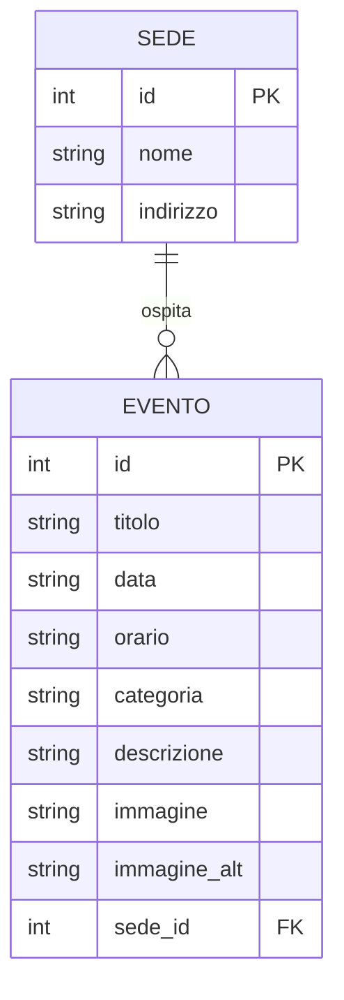

# Scheda Dati — Festival Segnale

Documentazione della struttura dati utilizzata per gestire il programma e le sedi del festival immaginario *Segnale*.

## 1. Entità
Il modello dati si basa su due entità principali:
* **Sede** (`dati/sedi.json`): rappresenta i luoghi fisici che ospitano il festival.
* **Evento** (`dati/eventi.json`): rappresenta i singoli appuntamenti in programma (incontri, laboratori, mostre).

---

## 2. Campi delle entità

### Entità `Sede`

| Campo | Tipo | Descrizione | Esempio |
| :--- | :--- | :--- | :--- |
| `id` | Numero intero | Identificativo univoco della sede | `1` |
| `nome` | Stringa | Nome dello spazio e denominazione della sede | `"Officina Nord — Sede centrale"` |
| `indirizzo` | Stringa | Indirizzo stradale e città | `"Corso Duca degli Abruzzi 24, Torino"` |

### Entità `Evento`

| Campo | Tipo | Descrizione | Esempio |
| :--- | :--- | :--- | :--- |
| `id` | Numero intero | Identificativo univoco dell'evento | `1` |
| `titolo` | Stringa | Titolo dell'appuntamento | `"Lettere in movimento"` |
| `data` | Stringa (Data ISO) | Giorno dell'evento (`AAAA-MM-GG`) | `"2026-06-12"` |
| `orario` | Stringa | Ora di inizio (`HH:MM`) | `"10:00"` |
| `categoria` | Stringa | Tipologia di attività (`Incontro`, `Laboratorio`, `Mostra`) | `"Incontro"` |
| `descrizione` | Stringa | Breve testo descrittivo dell'evento | `"Come cambia un messaggio quando cambiano le lettere?..."` |
| `immagine` | Stringa | Percorso relativo del file grafico associato | `"assets/lettere-in-movimento.svg"` |
| `immagine_alt` | Stringa | Testo alternativo per l'accessibilità dell'immagine | `"Lettere geometriche disposte su una griglia"` |
| `sede_id` | Numero intero | Chiave esterna che collega l'evento alla sua sede | `1` |

---

## 3. Chiavi primarie
* **`Sede.id`**: chiave primaria numerica, univoca all'interno di `sedi.json` e stabile nel tempo.
* **`Evento.id`**: chiave primaria numerica, univoca all'interno di `eventi.json` e stabile nel tempo (non richiede numerazione consecutiva).

---

## 4. Relazioni
Tra **Sede** ed **Evento** esiste una relazione **uno-a-molti (1:N)**:
* Una **Sede** può ospitare più eventi (`0` o molti).
* Ogni **Evento** si svolge in una sola sede.
* Il collegamento avviene tramite la chiave esterna **`Evento.sede_id`**, che fa riferimento alla chiave primaria **`Sede.id`**.

---

## 5. Quantità
* **Sedi**: 3 record (`id` da 1 a 3).
* **Eventi**: 6 record (`id` da 1 a 6, distribuiti su due giornate).

---

## 6. Gestione e aggiornamento
* **Chi aggiorna i dati**: chi gestisce il progetto (studente/redazione del festival).
* **Come avviene l'aggiornamento**: modificando direttamente i file `dati/sedi.json` e `dati/eventi.json` nella repository (rispettando la sintassi JSON e la coerenza degli ID) ed effettuando il commit/push per la pubblicazione online.

---

## 7. Che cosa mostra la pagina
La pagina **Programma** legge dinamicamente i dati dai due file JSON, incrocia ciascun evento con la corrispondente sede (tramite `sede_id`) e mostra all'utente l'elenco completo degli appuntamenti con:
* Data, orario e categoria;
* Titolo, descrizione e illustrazione dedicata;
* Nome e indirizzo della sede in cui si svolge l'evento.

---

## Schema Relazionale (ER)

